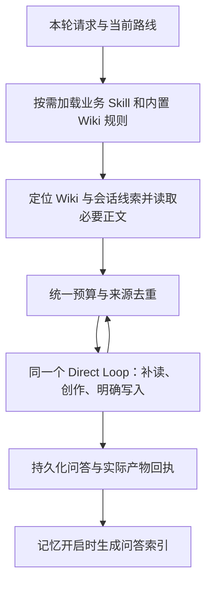

# Web 统一创作 Runtime 与 Wiki 记忆查询 TDD

> 日期：2026-10-15；工作分支：`1001-shoujiweb`；规划基线：`05fe2bcf`。
> 状态：已实施 Web 业务链路；定向自动化、类型检查、Web 构建和本地浏览器入口验证通过。真实模型、生产及原生平台验收待做；完整前端回归仍有与分支基线相同的27项既有失败。
> 用户决定：融合桌面端漫剧制作、短剧写作、小说创作的业务能力，与 Wiki-Memory、记忆索引、查询和动态上下文，形成唯一 Web Runtime。

## 1. 目标与范围

三条创作路线、普通对话、自选 Skill 和 Wiki 操作共用当前 `runMemoryChat → runDirectChatCompletion` 链路。业务 Skill 负责创作方法，Wiki-Memory 负责读写规则，Runtime 负责工具执行、预算、保存与回执。

本轮在 Web 支线复用桌面的业务能力；不整体合并 `main`，不改桌面 Harness Session，不恢复旧 Studio 或独立漫剧工作台。Web 已有文件、Skill、媒体、画布、账号与同步能力保留。移动浏览器属于验证范围；原生 iOS 发布另行验收。

| 数据 | 唯一正文来源 | 用途 |
| --- | --- | --- |
| 完整问答 | 现有 Raw 对话 | 对话连续性、追溯历史 |
| 创作资料与产物 | 项目 Wiki 普通文件 | 人物、关系、规则、规划、剧本、章节和提示词 |
| 记忆索引 | 从完整问答派生 | 名称、关系、事件和用户修改的导航 |
| 写作方法 | App 内置 Skill 包 | 按任务读取业务规则与参考 |
| 模型上下文 | 本轮实际读取的材料 | 临时投影，不成为第二份正文数据库 |

Wiki 文件中也有草稿、规划与参考，不能因存在于文件树就认定已经采用。用户本轮明确修改要求优先，历史建议与正式资料冲突时必须说明依据。

## 2. 现状与复用点

| 代码现状 | 证据 | 最小调整 |
| --- | --- | --- |
| 已共用 Direct Loop | `memoryChat.ts`、`directEngine.ts` | 保留一个入口与循环，统一读取和收尾 |
| 固定三轮/24K | `creativeMemory.ts` | 用完整请求预算替代固定轮数和历史限额 |
| Wiki 与记忆查询分叉 | `memoryChat.ts` 的 `wikiMemorySelected` 分支 | 查询时组合两类导航，正文按需读取 |
| 只总结助手回答、两次最多12词截断 | `conversationMemorySummary.ts`、`conversationMemoryIndex.ts` | 完整问答建索引，增强名称/事件覆盖并调整限额 |
| 查询取助手原文，预取只截前6000字符 | `conversationMemoryIndex.ts`、`memoryChat.ts` | 关联用户问题，保留来源，按任务和预算选择片段 |
| 宽泛正则把“继续/同意/分析”也当成写意图 | `hasWikiWriteIntent()` | 模型理解本轮意图与明确待执行任务，工具层校验对象、范围与版本 |
| 运行态和索引收尾在界面组件内 | `MemoryWorkbench.vue` 的 `runs`、完成回调 | 收尾归原任务，视图只负责显示 |
| 缺少桌面三路线的当前完整包 | 本支线 `public/skills` | 同步必要 Skill、路由清单与完整引用资源 |
| 桌面共享归档依赖 Node/Harness | `main` 的 `manju-wiki.mjs`、`wiki-artifacts.json` | 复用合同与纯规则，通过 Web 文件服务执行 |
| 部分自动索引测试只是占位断言 | `memoryChat.autoindex.test.ts` | 以可观察输入输出与故障注入替换 `assert.ok(true)` |

桌面参考文件：`manjuProduction.ts`、`shortDramaProduction.ts`、`novelProduction.ts`、`manju-route.json`、`wiki-artifacts.json`、`src-tauri/resources/deepseek-harness/{manju-skills,manju-wiki}.mjs`，以及三路线和共同归档合同。桌面实现作为只读参考，不视为本支线已具备能力。

## 3. 一条执行链

后续工具请求重新经过预算，不增加独立 Planner、归档 Agent 或额外主循环。资料足够时直接创作。

### 三条创作入口

- 「漫剧制作」复用桌面资料、视觉资产、脑暴、工程台本、H3/Seedance 提示词及白名单；其默认提示词路由仅在该路线内生效。
- 「短剧写作」复用文学剧本、改编方向、分集创作与修订。
- 「小说创作」复用规划、设定、章纲、章节起草与修订；参考和引擎按需读，不将全部参考塞入上下文。
- 三路线互斥；普通对话和其他 Skill 保留。提示词创作使用对应路线/Skill，不建第四个 Runtime。
- 点击入口仅切换当前对话路线，不读取资料、不建库、不生成媒体。选择与恢复只维护一份实际生效状态。
- 发送时锁定项目、会话、路线、Skill、模型与记忆/查询开关；途中切换只影响下一轮。

### Wiki-Memory 内置

复用一份现有规则，按需加载基础读写规则或故事/知识沉淀参考。无需用户手选；旧会话显式选择记录继续可读，规则不重复装载，不删除桌面或用户 Skill。

查询开启时，组合当前项目 Wiki 导航与当前会话索引，定位目标正文及一层相关直接关系；不足时通过同一循环补读。普通对话也具备必要只读能力，不能被“未选 Skill 不开放工具”的旧门禁阻断。

索引和简介用于导航，正文才提供具体依据。Wiki 足够时不读取重复回答；近期未归档的修改线索仍可参与。多个作品、同名人物或双 Wiki 根无法唯一定位时不混合资料。其他对话仅由用户显式引用加入。

“王刚的初恋安排一个情节”应读取王刚的真实人物资料、相关关系/往事和近期修改，再创作；未记载初恋身份时可给标明为新增构思的候选，不能伪造既有设定或自动归档备选。

## 4. 两个开关与写入合同

| 行为 | 控制来源 |
| --- | --- |
| 回答成功后自动建立记忆索引 | 记忆开关 |
| 自动补充 Wiki 与历史资料 | 查询开关 |
| 用户明确“查 Wiki / 读取此文件” | 本轮显式请求，开关关闭仍可执行 |
| 用户明确“把刚才设定写入 Wiki / 更新人物页” | 本轮显式请求，无需手选 Skill |
| 三路线明确要求的正式产物 | 沿用桌面“创作并保存到当前项目”合同，入口说明该行为 |
| 讨论、候选比较、点击入口、“只在对话里/不要保存” | 不自动写入 Wiki |

近期上下文连续性始终保留，不随两开关关闭。开启记忆不等于把每条回答变成作品事实。

写入遵循以下规则：

1. 模型理解任务、读取真实目标与选择内容；Runtime 校验项目范围、文件版本、参数及来源。“不要写入”“解释如何写入”不触发写工具。“继续/同意”只有明确承接已有待执行写入时才延续授权，不取得新的写入范围。
2. 普通 Wiki 修改复用文件工具；已有类型化创作产物通过同一个 `wiki_save_artifact`。两种入口共用根定位、版本与索引规则，避免三路线各建保存器。
3. 复用现有 Wiki 根与真实索引路径；缺根仅在首次实际保存时创建必要结构。多根或同名冲突明确处理，不另建平行 Wiki。
4. 正文写入并读回后更新直属索引与必要双链。正文成功、索引失败时保留正文并报告部分成功；重试只补缺项。
5. 小说正文先保存草稿；只有明确确认对应且完全一致的已保存版本，才追加正式原文。复用桌面指纹、重复提交及确认记录规则。“继续”、记忆记录成功与草稿保存都不代替确认。
6. 回执绑定发起项目和会话，文件树按真实路径刷新定位。保存不自动启动下一章/集、故事拆分或媒体任务。

## 5. 记忆索引最小增强

继续用 `summary + keywords + Raw 正链`，同一次现有索引请求输入完整问答：

- 关键词覆盖回答明确出现的角色名、场景名、道具名，再补关键关系、事件与用户修改词；有依据时保留别名或补足指代，不猜身份。
- 简介写清“谁与谁、发生什么、必要条件是什么”，保留否定、误解、尚未揭晓与备选性质；用户要求和模型创作补充分开表达。
- 同步调整提示词、解析器、两处12词截断和必要输出预算；不能模型已提取却被程序静默删除。资源仍有限，名称完整性须用真实长输出验证。
- 沿用稳定 turn 引用；可选关联用户 turn，兼容旧 V1/V2，不另存一份问答。真实 Wiki 写入回执可提供页面线索，不猜归档路径。
- 正式产物保存后，Runtime把真实路径作为程序回执写入回答；索引时读取回执指向的Wiki正文，与完整问答共用原来的单次索引请求，避免“回答只有已保存、正文实体漏索引”。关键词同时保留实际路径；不复制第二份正文、不把草稿当已确认事实。
- 问答成功持久化后才自动建索引；失败不回滚回答或 Wiki 正文，保留“未记录/重试”。离开当前视图不应跳过收尾。
- 编辑重发或删除后排除失效索引；补建限当前对话并依据实际保留轮次，不自动批量迁移全部历史。

长输出是否拆成多条场景索引，由真实漏召回证据决定，本期不增加新分块协议。

## 6. 动态上下文

删除固定三轮/24K主策略，按完整请求预算选择最近完整问答、Wiki正文和查询片段，不发送全部历史，也不为填满窗口而加入无关资料。

`完整输入估算 + 本次输出预留 + 安全余量 ≤ 当前可用上下文容量`

- 容量优先采用当前 provider/endpoint/model 的实际运行声明，其次有效元数据和缓存。列表没有容量字段不算探测成功；切换路由重新计算，未知容量标记估算并保守处理，现有云端1M默认值不能当成已验证能力。
- 计入系统规则、Skill与参考、工具schema、附件、Wiki/历史和当前消息；保留现有 `tokenx` 计量，实际 provider usage 单独记录。已有消耗不能反推窗口上限。
- 当前请求、必需修改原文与相关硬约束优先保留。先去重复和无关材料，再减少较旧完整问答或可选查询，不静默截断关键名字、对白、否定和提示词参数。
- Wiki/历史按实际来源、版本或turn去重；查询围绕命中位置取材，不再统一取每条前6000字符。必要原文本身超预算时明确说明并分段处理。
- 每次工具结果、Skill参考或模型变化后重算，调用与结果保持配对；不以只留两轮工具结果代替任务连续性。
- 不支持工具调用的模型继续支持普通文字请求；需要实际读写时说明能力不足，不声称已查或已保存。

## 7. 最小改动面

| 接缝 | 职责 |
| --- | --- |
| `MemoryWorkbench.vue` | 三入口、对话选择状态、每轮快照、显示；任务收尾不依赖当前是否在屏幕 |
| `memoryChat.ts` | 保持唯一入口；按需Skill、内置Wiki、统一查询与工具执行 |
| `creativeMemory.ts`、`directEngine.ts` | 总预算、来源去重、轮次/工具配对，每次请求前检查 |
| `conversationMemorySummary.ts`、`conversationMemoryIndex.ts` | 完整问答索引、名称/事件覆盖、有效性与旧格式兼容 |
| `memoryProject.ts`、`ProjectFileService` | 复用会话保存、版本保护和文件树事件 |
| 桌面三路线包、路由清单、`wiki-artifacts.json` 的必要依赖 | 同步创作能力、产物映射及全部实际参考 |
| 必要的Web产物执行模块 | 复用纯路径/索引规则，以ProjectFileService执行；不拷贝整个Node/Harness插件 |
| Skill资源解析和构建目录 | 子Skill和全部ref在浏览器可达，按需读取 |
| 现有模型目录、Store、容量显示 | 贯通容量元数据和未知值，不建第二个模型注册表 |

能原地复用就不增加抽象；`runMemoryChat` 是否改名不是目标。不复制桌面专属进程、终端或文件系统能力到浏览器。

## 8. 分阶段TDD

| 阶段 | 工作 | 完成条件 |
| --- | --- | --- |
| P0 合同 | 本文、能力保留、源文件与依赖清单 | 现状与验收可对应，状态如实记录 |
| P1 Wiki与归档 | 内置规则、统一读取、明确写入、Web产物执行 | 无需手选即可查写；根、版本、索引和失败重试闭环 |
| P2 三路线 | 同步包与入口，复用一个Loop和项目Wiki | 三路线及普通对话能连续使用；切换不建第二库 |
| P3 索引与上下文 | 完整问答索引、查询匹配、总预算和去重 | 超三轮接续、人物召回、长正文和多工具轮通过 |
| P4 回归与平台 | 视图解耦、旧数据兼容、构建与真实创作 | 不串项目；真实Web和移动浏览器验收分别记录 |

各阶段先写可复现的行为红测，再做最小实现和定向回归。以下是验收合同，已执行范围见第10节，不把整张矩阵视为已通过：

| 场景 | 必须验证的行为 |
| --- | --- |
| 三入口点击、退出和重开 | 只切换/恢复路线，无生成或建库副作用；普通对话、其他Skill仍可用 |
| 漫剧/短剧/小说各调用参考资源 | 包完整且浏览器可读，缺文件明确失败，不依赖DSH |
| 王刚的初恋情节 | 读人物与直接关系；真实事实和新构思区分；同名/多根不混合 |
| Wiki尚未同步“不要复合” | 最近修改进入依据，旧复合候选不变成事实 |
| 四种记忆/查询开关组合 | 自动行为独立受控，连续性保留，显式读写可执行 |
| 写入Wiki、不要写入、解释写入、无待办时“同意” | 正确触发或不触发；引用资料不产生写入授权 |
| 写第3集/续写下一章，及“不要保存”变体 | 正式交付按路线保存；明确不保存仅对话交付；小说为草稿 |
| 小说明确确认、重复确认与草稿版本变化 | 一致版本才追加，重复幂等，变化不覆盖；继续不自动确认 |
| 正文保存后索引失败，再重试 | 正文保留、部分成功可见，只补未完成步骤 |
| 用户同时编辑Wiki文件 | 版本冲突可见，人工正文不被旧模型输出覆盖 |
| 超12个实体、用户约束仅在问题中 | 名称不被旧限额裁掉，完整问答可定位，限定含义保留 |
| 索引失败、编辑重发和删除旧轮次 | 不回滚回答，不召回失效条目，重试幂等 |
| 五轮短问答仍在预算内 | 不因三轮硬限制丢掉需要的历史 |
| Wiki、记忆和最近历史含重复内容 | 来源去重，完整请求预算包含规则、工具和附件 |
| 多轮长工具结果、加载参考、换小窗口模型 | 每次重算，工具配对与必需内容完整，超限明确说明 |
| 容量未知/模型不支持工具 | 不伪报容量或读写成功，普通文字能力仍可用 |
| 生成/索引时切对话或项目 | 内容与回执归原任务，新项目不被写入或定位 |
| 中断或索引失败后刷新 | 已保存结果保留，缺索引可重试，未完成生成不冒充成功 |
| 提示词创作未请求媒体生成 | 不提交媒体；现有媒体工具仍可按明确请求使用 |

测试以假模型、可观察请求和内存文件适配器验证闭环；不以源码正则或占位断言代替功能。三路线真实模型各走一次“读取→创作→保存→下一轮复用”，另测移动浏览器布局、输入与切换。模型、自动测试、构建和人工平台结果分开记录。

## 9. 完成定义与本次交付

三路线、普通对话、自选Skill、Wiki读写、记忆和动态上下文经过同一执行链；用户在文件树找到真实结果并可在下一轮复用，既有数据与能力保留，才算完成。

本期不增加向量/实体数据库、整本生产器、第二Loop、后台队列或每轮Planner；不承诺浏览器关闭或系统冻结后继续生成，恢复以已持久化结果为准。旧Raw、V1/V2索引与Wiki不批量迁移、改名或删除。

规划轮仅交付文档；用户随后明确要求保持本支线逐项实施。实际改动与验证如下，未修改生产配置或既有用户数据。

## 10. 2026-10-15 实施与验证记录

| 阶段 | 已实施 | 验证边界 |
| --- | --- | --- |
| P0 | 在现有 `1001-shoujiweb` 工作树实施，`main` 只读且保持干净 | 未提交、推送、合并或部署 |
| P1 | Wiki-Memory 自动内置；Wiki和当前会话线索共同导航；显式查写不受自动查询开关阻断；普通文件与类型化产物均保护已读版本 | 内存文件与假模型闭环；未以真实模型证明自然语言意图判定准确率 |
| P1 归档 | 共用桌面 `wiki-artifacts.json`；必要目录索引按需创建；正文读回、部分成功和同内容重试；多根在用户明确选择后以 `wiki_root` 限定 | 小说一致版本确认、重复幂等、索引故障、人工并发修改及越界参数已有测试 |
| P2 | 三入口互斥、选择存Raw会话头、发送锁定能力快照；同步13个创作Skill及完整引用资源，连同原4个共17包 | 三路线各经相同 `runMemoryChat` 读取真实包、保存真实测试文件；不依赖Node/Harness |
| P3 | 完整用户问题+回答建索引；移除两处12词截断，保留名称与否定/条件；中文分词与名称匹配，同分优先近期线索；返回已核验问答及命中附近分页 | 已测试超过12个名称、自然中文人物请求、前6000字符外的道具、用户约束和失效turn |
| P3 上下文 | 删除固定三轮/24K；每次请求计入规则、参考、工具、附件与输出预留；旧轮整组淘汰，可选导航让位，工具调用/结果保持配对；必需内容超预算明确报错并保留输入草稿 | 计量使用tokenx估算，不宣称等于每家供应商真实计费token；不增加额外摘要模型或第二Loop |
| P3 容量 | 沿用模型目录读取 `contextWindow/context_window/context_length/max_context_tokens/top_provider` 声明；未知时显示估算，32K/4K保守兜底；旧1M伪元数据缓存先降为估算 | 真实声明1M仍保留；不是所有 `/v1/models` 都提供窗口，未增加会谎报成功的“自动探测” |
| P4 收尾 | 自动索引不再受“是否在屏上”门禁阻断；服务从持久化Raw取问答，按发起项目/会话/模型执行，编辑后旧结果不写索引；失败保留回答并可重试 | 退出整个工作台仍中断生成；关闭浏览器不承诺继续工作，无后台队列 |

### 自动化结果

- 九组关键测试共 **63/63**：`wikiArtifacts`、`creationRoutes`、`memoryChat.runtime`、`memoryChat.autoindex`、`memoryChat.context`、`conversationMemoryIndex`、`conversationMemorySummary`、`creativeMemory`、`webProjectTools`。假模型与内存适配器不使用API Key，不产生付费调用；包含“保存提示不丢正文实体”的单次索引请求验证。
- `pnpm exec vue-tsc -b`、`pnpm run build:quick` 和其中 `audit:web-dist` 通过；定向lint没有错误，既有文件的历史警告不冒充已清理。
- 完整前端focused：**1487项，1460通过，27失败**。用 `git archive HEAD` 的临时快照复跑基线：**1461项，1434通过，27失败**；逐项比较失败名称，没有新增失败项。既有媒体、界面源码断言和测试登记失败未越界修复，完整回归不得登记为全绿。
- 未运行Rust测试或原生打包；本次未修改Rust、Harness或原生平台配置。

### 本地浏览器结果

在独立 `http://127.0.0.1:1438/try/` 创建“Runtime验收-虚构资料”测试项目，没有登录、上传或调用模型：三入口可见且互斥，刷新保留路线，新对话不继承旧路线，窄屏实测354 CSS px无横向溢出。未触碰生产域名、现有项目或真实创作资料。截图保存在本轮临时验收附件中。

### 明确未验收

真实模型逐路线的事实遵循、全部实体提取率、自然语言否定/确认识别、多轮长篇创作质量、图片等多模态实际token差异，以及真实iPhone/Safari/Windows/Intel Mac、用户数据升级、安装包和生产发布仍待单独验收。上述限制不因构建或假模型测试通过而消失。
